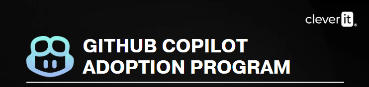

<div align="center">


# 🤖 Workshop 2 — GitHub Copilot CLI: Agents, Git, MCP, and Extensibility

**Hands-on issue → fix → test → PR, GitHub MCP, AGENTS.md, and Agent Skills**

**⏱️ Total duration: 90 minutes**

</div>

---

This workshop brings together the practical content from modules M2 and M3 in **six 15-minute labs**. Participants work with the agent as an executor of real tasks: resolving issues, investigating bugs, generating tests, operating GitHub using natural language, defining persistent instructions, and building a small application guided by a brainstorming skill.

> [!TIP]
> This workshop assumes that GitHub Copilot CLI is already installed, authenticated, and running inside the practice repository. Prerequisites do not count toward the 90-minute lab.

---

## 📋 Table of Contents

1. [🎯 Learning objectives](#-learning-objectives)
2. [⏱️ Estimated duration](#️-estimated-duration)
3. [📚 Prerequisites](#-prerequisites)
4. [🛠️ LAB 2A. Complete Fix + PR from the CLI](#️-lab-2a-complete-fix--pr-from-the-cli)
5. [🕵️ LAB 2B. Bug Hunter](#️-lab-2b-bug-hunter)
6. [🧪 LAB 2C. Automated Tests with the Agent](#-lab-2c-automated-tests-with-the-agent)
7. [🔌 LAB 3A. GitHub MCP in Natural Language](#-lab-3a-github-mcp-in-natural-language)
8. [📜 LAB 3B. AGENTS.md and Persistent Rules](#-lab-3b-agentsmd-and-persistent-rules)
9. [💡 LAB 3C. Brainstorming and App Scaffolding](#-lab-3c-brainstorming-and-app-scaffolding)
10. [✅ Completion checklist](#-completion-checklist)
11. [🧭 Final reflections](#-final-reflections)

---

## 🎯 Learning objectives

By the end of this workshop, you will be able to:

- ✅ Resolve an issue with Copilot CLI and complete the **branch → change → commit → push → PR** workflow.
- ✅ Use the agent to investigate a bug starting from the latest commit.
- ✅ Apply a **red test → fix → green suite** workflow.
- ✅ Control agent tools using `--allow-tool` and `--deny-tool`.
- ✅ Operate issues and GitHub Actions from the CLI using GitHub MCP's native capabilities.
- ✅ Create an `AGENTS.md` with commit conventions, coding style, and critical restrictions.
- ✅ Validate that persistent instructions affect the agent's behavior.
- ✅ Use a brainstorming Agent Skill to go from an idea to a spec, plan, and scaffolding.

---

## ⏱️ Estimated duration

| Lab | Time |
| --- | ---: |
| 🛠️ LAB 2A — Fix + PR | 15 min |
| 🕵️ LAB 2B — Bug Hunter | 15 min |
| 🧪 LAB 2C — Automated Tests | 15 min |
| 🔌 LAB 3A — GitHub MCP | 15 min |
| 📜 LAB 3B — AGENTS.md | 15 min |
| 💡 LAB 3C — Brainstorming | 15 min |
| **Total** | **90 min** |

> [!IMPORTANT]
> To stay within the 90-minute limit, each block has a strict timebox. If a remote operation (push, PR, GitHub Actions, or cloud agent) takes longer than expected, continue with the local checkpoint and return to remote validation at the end.

---

## 📚 Prerequisites

Before you begin:

- GitHub Copilot CLI must be installed and authenticated.
- The workshop repository must be cloned locally.
- You must be able to run `git pull`, create branches, and run the project's tests.
- For steps that create issues or PRs, you need sufficient repository permissions.
- The CLI must be run from inside the repository directory.

> [!NOTE]
> The transcript indicates that some participants may not have permission to complete the push/PR in a corporate tenant. In that case, the workflow can be practiced on a copy or personal repository authorized by the instructor.

---

## 🛠️ LAB 2A. Complete Fix + PR from the CLI

**⏱️ 15 minutes**

**Objective:** delegate a documented GitHub bug to the agent and complete a Pull Request without leaving the terminal.

### 1. Open Copilot CLI

From the repository:

```bash
copilot
```

Work in **Normal Mode** so you can review each action.

### 2. Check open issues

Send:

```text
What open issues does this repository have?
```

### 3. Choose a bug

Select one of the bugs documented in the issues.

The material uses as an example a problem in `validateEmail` that does not validate subdomains. If that issue is available, you can use an equivalent prompt:

```text
There is a bug in validateEmail: it does not validate subdomains.
Fix it, create the fix/validate-email branch, and open a PR.
```

### 4. Review each action

In Normal Mode, verify that the agent proposes or executes, with your approval, a workflow equivalent to:

```text
1. Inspect the affected file.
2. Modify the implementation.
3. Create a fix branch.
4. Stage the changes in Git.
5. Create a commit.
6. Push the branch.
7. Create a Pull Request.
```

### 5. Validate the PR

Open GitHub.com and confirm that the Pull Request was created correctly.

### Checkpoint

- [ ] Issue identified.
- [ ] Branch created.
- [ ] Change reviewed.
- [ ] Commit created.
- [ ] PR created or workflow prepared up to the limit allowed by your environment.

> [!TIP]
> The goal is not to accept everything automatically. Observe which tools the agent requests to use and which Git command it proposes at each stage.

---

## 🕵️ LAB 2B. Bug Hunter

**⏱️ 15 minutes**

**Objective:** investigate a recent change, test the bug before fixing it, and close the loop with tests.

### 1. Pull the latest change

```bash
git pull
```

### 2. Ask for an analysis of the latest commit

```text
Analyze the latest commit. What changed, and is there a problem?
```

Read the diagnosis. **Do not approve changes yet.**

### 3. Test the bug first

```text
Write a test that fails if the bug exists. Run it.
```

### Expected result

You should see a **red** test reproducing the problem.

> [!IMPORTANT]
> Do not continue with the fix until you have evidence that the test actually fails because of the identified bug.

### 4. Fix it and run the suite

```text
Fix it. Run the full suite with no regressions.
```

### 5. Create the PR

```text
Open a PR with the fix describing the bug that was found.
```

### Checkpoint

- [ ] The agent explained the latest commit.
- [ ] The bug was reproduced with a failing test.
- [ ] The fix made the test pass.
- [ ] The full suite was run.
- [ ] The PR documents the bug that was found.

---

## 🧪 LAB 2C. Automated Tests with the Agent

**⏱️ 15 minutes**

**Objective:** compare the traditional interactive workflow with a session that pre-approves `shell` while blocking a risky operation.

### 1. Launch Copilot with tool controls

Exit the current session if necessary and run:

```bash
copilot --allow-tool='shell' --deny-tool='shell(rm)'
```

### 2. Identify functions without tests

```text
Identify functions in src/ that do not have test coverage.
```

### 3. Generate the missing tests

```text
Write the missing tests using the testing framework this project already uses.
```

### 4. Run and validate

```text
Run the tests and verify that they all pass.
```

If there is a failure:

```text
Diagnose why the test fails and fix it without removing the coverage you just added.
```

### 5. Compare the experience

Compare this experience with a session without `--allow-tool='shell'`.

### Expected result

The agent can run authorized shell commands with fewer interruptions, while `shell(rm)` remains explicitly denied.

### Checkpoint

- [ ] Functions without tests were identified.
- [ ] Tests were added using the project's testing framework.
- [ ] The suite was run.
- [ ] You understand the difference between allowing a tool and blocking a sub-operation.

---

## 🔌 LAB 3A. GitHub MCP in Natural Language

**⏱️ 15 minutes**

**Objective:** manage GitHub resources from the CLI using natural language.

### 1. Enable the available GitHub MCP toolsets

```bash
copilot --enable-all-github-mcp-tools
```

### 2. List issues

Inside Copilot:

```text
List all open issues in this repository.
```

You can also try:

```text
Which open issues are assigned to me?
```

### 3. Create an issue from the terminal

Use a clear description. The material gives this example:

```text
Create an issue: "Rate limiting on /login" with the "security" label.
```

### 4. Review GitHub Actions

Run:

```text
/view actions
```

### 5. Assign an issue

For example:

```text
Assign issue #12 to my user.
```

Replace `#12` with a valid issue from the repository.

### 6. Observe delegation with `&`

If your plan and environment policies allow it, try:

```text
& Implement the rate limiting from issue #12
```

### Expected result

You should verify that the agent can query and operate GitHub resources using native tools, without manually navigating the UI for each operation.

> [!NOTE]
> Delegation with `&` may depend on the plan and policies enabled for the organization. If it is unavailable, record the CLI response and continue with the next lab.

---

## 📜 LAB 3B. AGENTS.md and Persistent Rules

**⏱️ 15 minutes**

**Objective:** create repository instructions that define how the agent should behave when working with the project.

### 1. Ask for a proposal based on the repository

```text
Generate an AGENTS.md based on the conventions you observe in the code.
```

### 2. Review and adjust

The file must contain, at a minimum:

- Commit convention.
- Branch naming convention.
- Coding style.
- Testing rules.
- At least one critical restriction.

The material uses the following as a reference:

```markdown
# AGENTS.md — API Project

## Commits and branches
- Conventional Commits: feat:, fix:, chore:, docs:, test:
- Branch naming: feature/, fix/, chore/, docs/
- NEVER push directly to main or develop

## Coding style
- Strict TypeScript, no `any`
- Tests with Jest using the describe/it pattern
- Minimum coverage: 80%
- JSDoc required for public functions

## Critical restrictions
- DO NOT modify /migrations without the user's explicit confirmation
- DO NOT run scripts that affect the production database
```

> [!NOTE]
> Keep only the rules that make sense for the actual repository. The example is a reference template, not an instruction to invent technologies or conventions that the project does not use.

### 3. Restart the agent

Save the file and restart the session as indicated in the material:

```text
/restart
```

### 4. Test the commit rule

Ask the agent to create a commit for a controlled change and verify that it follows **Conventional Commits**.

### 5. Bonus: create a basic Skill

The per-repository location shown in the material is:

```text
.github/skills/MY-SKILL/SKILL.md
```

A minimal frontmatter can contain the fields described in the material:

```yaml
---
name: my-skill
description: Describe when and why this skill should be used
allowed-tools: [shell]
user-invocable: true
---
```

Then add Markdown instructions below the frontmatter and try to invoke it with the corresponding slash command.

### Checkpoint

- [ ] `AGENTS.md` created and reviewed.
- [ ] Actual repository conventions documented.
- [ ] Critical restriction included.
- [ ] Session restarted.
- [ ] Agent behavior validated with at least one rule.

---

## 💡 LAB 3C. Brainstorming and App Scaffolding

**⏱️ 15 minutes**

**Objective:** quickly move from an idea to a specification, plan, and scaffolding using a brainstorming skill.

### 1. Choose an idea

The material proposes three examples:

- `prompt vault`
- `daily dev log`
- `tech debt board`

You can also choose another simple idea approved by the instructor.

### 2. Keep the lab's technical constraints

The application must use:

```text
Next.js 15
Server Functions
Local database
```

### 3. Request scaffolding

In Copilot, ask for help creating the application's initial structure while respecting those constraints.

Example prompt derived from the lab:

```text
I want to create a <IDEA> application.
It must be built with Next.js 15, use Server Functions, and use a local database.
First, propose the project scaffolding. Do not add technologies that are not necessary for these requirements.
```

### 4. Create a spec through brainstorming

Invoke the `brainstorming` skill installed for the workshop and use it to turn the idea into a sufficiently clear specification.

The transcript emphasizes that the workflow may ask questions and propose different directions before finalizing the specification.

### 5. Generate a plan

Once the spec is accepted, ask the agent to produce the implementation plan before building.

### 6. Implement and prepare a PR

Let the agent complete the scaffolding within the timebox and finally ask it to prepare a PR targeting `main`, without pushing directly to `main`.

### Expected result

At the end of the 15 minutes, you should have at least:

- A chosen idea.
- A spec generated through brainstorming.
- An implementation plan.
- Functional or in-progress initial scaffolding.
- A PR workflow prepared or completed, depending on permissions and time.

> [!TIP]
> The goal of this lab is not to finish a complete product. It is to practice the **idea → questions → spec → plan → execution** cycle within an agent session.

---

## ✅ Completion checklist

- [ ] An issue was used as the starting point for a fix.
- [ ] The red test → fix → green suite cycle was practiced.
- [ ] `--allow-tool` and `--deny-tool` were tested.
- [ ] Issues or Actions were operated through GitHub MCP.
- [ ] An `AGENTS.md` was created and validated.
- [ ] The difference between `AGENTS.md` and a reusable Skill was understood.
- [ ] A spec and plan were created from an idea using brainstorming.
- [ ] At least one Pull Request workflow was prepared.

---

## 🧭 Final reflections

- The agent can handle a complete Git workflow, but the developer remains responsible for reviewing the changes and permissions used.
- The **test first, fix afterward** pattern makes it possible to verify that the agent is correcting the right problem.
- `--allow-tool` improves flow; `--deny-tool` makes it possible to maintain explicit boundaries.
- GitHub MCP brings issues, PRs, and Actions into the same terminal workflow.
- `AGENTS.md` contains persistent repository rules; Skills encapsulate reusable procedures that are loaded when relevant.
- A good agent workflow starts with a clear specification and a reviewable plan before delegating implementation.

---